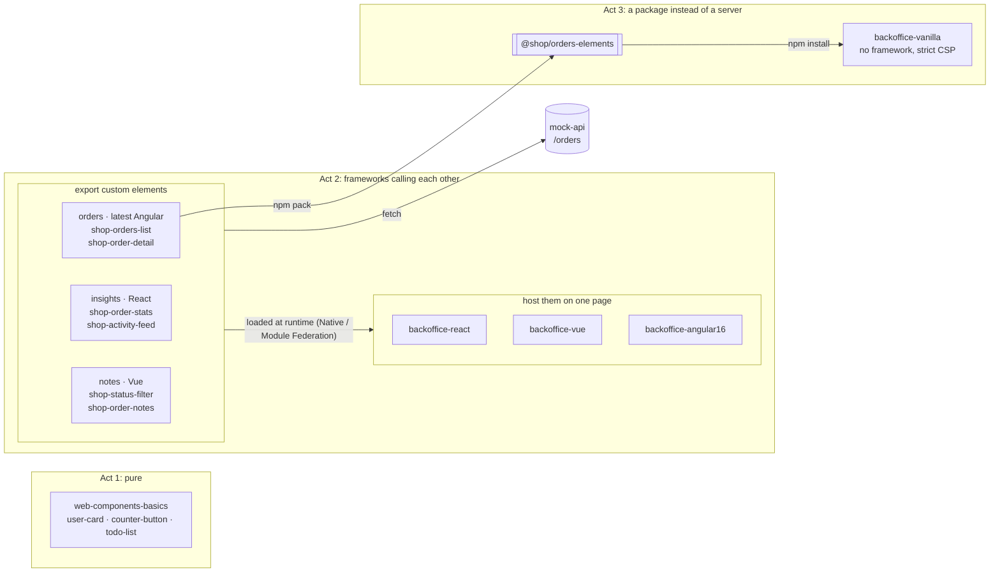

# Web Components & Micro-Frontends

**One online shop back office. Three acts. One contract: the custom element.**

> This is the companion repository of the talk *Web Components & Micro-Frontends*.
> Every demo from the talk runs from here, and [docs/showcase.md](docs/showcase.md) is the
> script it follows.

## The three acts

### Act 1: Pure Web Components

[`examples/web-components-basics`](examples/web-components-basics): three components written
with nothing but the browser. A class, a tag, attributes in, events out.

```js
class UserCard extends HTMLElement {
  static observedAttributes = ['name'];
  attributeChangedCallback() {
    this.#name.textContent = this.getAttribute('name');
  }
}
customElements.define('user-card', UserCard);
```

### Act 2: Frameworks calling each other

Three teams ship their features as custom elements, each with its own framework:

| App | Framework | Exports |
| --- | --- | --- |
| [`apps/orders`](apps/orders) | latest Angular | `<shop-orders-list>`, `<shop-order-detail>` |
| [`apps/insights`](apps/insights) | React | `<shop-order-stats>`, `<shop-activity-feed>` |
| [`apps/notes`](apps/notes) | Vue | `<shop-status-filter>`, `<shop-order-notes>` |

Three shells put all of them on one page: [`backoffice-react`](apps/backoffice-react),
[`backoffice-vue`](apps/backoffice-vue) and [`backoffice-angular16`](apps/backoffice-angular16).
The Angular 16 shell hosts components built with the latest Angular, so two Angular versions run
side by side. No app imports another app's code. They use the same contract as act 1:

```html
<shop-orders-list status="open"></shop-orders-list>
```

```js
await defineElements({ apiBase: 'http://localhost:3000' });
list.addEventListener('orderSelected', (event) => {
  detail.setAttribute('order-id', event.detail.id);
});
```

### Act 3: A package instead of a server

The Angular components are exported as the npm package `@shop/orders-elements` and installed
into [`apps/backoffice-vanilla`](apps/backoffice-vanilla), a page with no framework and a strict
Content Security Policy. Nothing is loaded from the Orders server: the code was installed,
reviewed and pinned by hash.

## How it fits together



The full contract (tags, attributes, events, theme tokens) is in
[docs/architecture.md](docs/architecture.md#contracts).

## Repository layout

```text
examples/
  web-components-basics/  act 1   plain JavaScript
apps/
  orders/                 act 2   latest Angular, exports custom elements
  insights/               act 2   React 19, exports custom elements
  notes/                  act 2   Vue 3.5, exports custom elements
  backoffice-react/       act 2   React shell
  backoffice-vue/         act 2   Vue shell
  backoffice-angular16/   act 2   Angular 16 shell
  backoffice-vanilla/     act 3   plain JavaScript, installs the package
packages/
  orders-elements/        act 3   @shop/orders-elements
tools/
  mock-api/               the orders REST API
docs/                     architecture, demo script, one guide per app
```

Every folder is its own npm project with its own `package.json`, as if a different team owned
each one.

## Run it

You only need [Docker Desktop](https://www.docker.com/products/docker-desktop/). No Node.js,
no Angular CLI, no version manager: every app builds and runs in its own container, and the
Angular 16 shell simply uses a Node 18 image.

```bash
docker compose up --build --watch
```

`--watch` copies every edit into the running containers, so the code on screen and the page
in the browser stay in step. `docker compose down` stops everything, and
`docker compose up -d --force-recreate mock-api` puts the orders back to their starting state
after a demo.

| Act | Open | Project |
| --- | --- | --- |
| 1 | `http://localhost:4100` | `examples/web-components-basics` |
| 2 | `http://localhost:4500/orders` | `apps/backoffice-angular16` |
| 2 | `http://localhost:4400/orders` | `apps/backoffice-vue` |
| 2 | `http://localhost:4200/orders` | `apps/backoffice-react` |
| 3 | `http://localhost:4600` | `apps/backoffice-vanilla` |
| | `http://localhost:3000/orders` | `tools/mock-api` |

The remotes run on 4201 (`orders`), 4202 (`insights`) and 4402 (`notes`).

## Status

The apps are being added one at a time, each through its own pull request.

| Stage | Adds | Act | State |
| --- | --- | --- | --- |
| 1 | Docs, mock API, editor settings, Docker Compose | | done |
| 2 | `web-components-basics` | 1 | done |
| 3 | `orders` (latest Angular) | 2 | done |
| 4 | `insights` (React) | 2 | done |
| 5 | `backoffice-react` | 2 | in review |
| 6 | `notes` and `backoffice-vue` | 2 | next |
| 7 | `backoffice-angular16` | 2 | planned |
| 8 | `@shop/orders-elements` and `backoffice-vanilla` | 3 | planned |
| 9 | Windows shortcuts | | planned |

## Tech stack

| Layer | Technology |
| --- | --- |
| Contract | Custom elements: attributes, properties, `CustomEvent`s |
| Styling | Shadow DOM and `--shop-*` CSS custom properties set by each shell |
| Loading | Native Federation (Angular), Module Federation (React, Vue), or an installed package |
| Safety | `textContent` everywhere, one error boundary per remote, strict CSP with packaged components |
| Code style | Strict TypeScript, ESLint, VS Code's built-in formatters |
