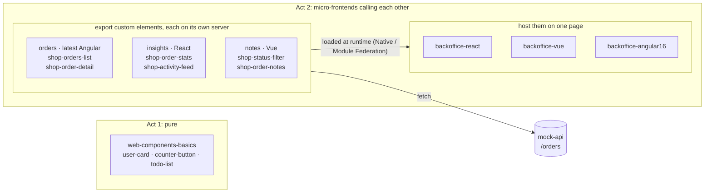

# Web Components & Micro-Frontends

**One online shop back office. Two acts. One contract: the custom element.**

> This is the companion repository of the talk *Web Components & Micro-Frontends*.
> Every demo from the talk runs from here, and [docs/showcase.md](docs/showcase.md) is the
> script it follows.

## The two acts

### Act 1: Pure Web Components

[`examples/web-components-basics`](examples/web-components-basics): three components written
with nothing but the browser. A class, a tag, attributes in, events out.

```js
class UserCard extends HTMLElement {
  static observedAttributes = ['name'];
  attributeChangedCallback() {
    this.#name.textContent = this.getAttribute('name');
  }
}
customElements.define('user-card', UserCard);
```

### Act 2: Micro-frontends calling each other

Three teams ship their features as custom elements, each with its own framework, and each runs
its own server:

| App | Framework | Exports |
| --- | --- | --- |
| [`apps/microfrontends/orders`](apps/microfrontends/orders) | latest Angular | `<shop-orders-list>`, `<shop-order-detail>` |
| [`apps/microfrontends/insights`](apps/microfrontends/insights) | React | `<shop-order-stats>`, `<shop-activity-feed>` |
| [`apps/microfrontends/notes`](apps/microfrontends/notes) | Vue | `<shop-status-filter>`, `<shop-order-notes>` |

Three shells load them at runtime, through Native Federation and Module Federation, and put all
of them on one page: [`backoffice-react`](apps/backoffices/backoffice-react),
[`backoffice-vue`](apps/backoffices/backoffice-vue) and
[`backoffice-angular16`](apps/backoffices/backoffice-angular16). The Angular 16 shell hosts
components built with the latest Angular, so two Angular versions run side by side. No app
imports another app's code, and a new release of a remote reaches every shell at the next page
load. They use the same contract as act 1:

```html
<shop-orders-list status="open"></shop-orders-list>
```

```js
await defineElements({ apiBase: 'http://localhost:3000' });
list.addEventListener('orderSelected', (event) => {
  detail.setAttribute('order-id', event.detail.id);
});
```

## How it fits together



The full contract (tags, attributes, events, theme tokens) is in
[docs/architecture.md](docs/architecture.md#contracts).

## Repository layout

```text
examples/
  web-components-basics/    act 1   plain JavaScript
apps/
  microfrontends/           the apps that export custom elements
    orders/                 act 2   latest Angular
      contract/                     @shop/orders-contract
    insights/               act 2   React 19
      contract/                     @shop/insights-contract
    notes/                  act 2   Vue 3.5
      contract/                     @shop/notes-contract
  backoffices/              the shells that host them
    backoffice-react/       act 2   React
    backoffice-vue/         act 2   Vue
    backoffice-angular16/   act 2   Angular 16
tools/
  mock-api/                 the orders REST API
    contract/                       @shop/api-contract
  scripts/                  Windows shortcuts around docker compose
docs/                       architecture, demo script, one guide per app
```

Every folder is its own npm project with its own `package.json`, as if a different team owned
each one. Each team publishes what others may use as a types-only contract package in its own
folder, and the other apps install it from there (`npm install <folder>`), with no registry. See
[docs/architecture.md](docs/architecture.md#contracts).

## Run it

You only need [Docker Desktop](https://www.docker.com/products/docker-desktop/). No Node.js,
no Angular CLI, no version manager: every app builds and runs in its own container, and the
Angular 16 shell simply uses a Node 18 image.

```bash
docker compose up --build --watch
```

`--watch` copies every edit into the running containers, so the code on screen and the page
in the browser stay in step. `docker compose down` stops everything, and
`docker compose up -d --force-recreate mock-api` puts the orders back to their starting state
after a demo.

| Act | Open | Project |
| --- | --- | --- |
| 1 | `http://localhost:4100` | `examples/web-components-basics` |
| 2 | `http://localhost:4500/orders` | `apps/backoffices/backoffice-angular16` |
| 2 | `http://localhost:4400/orders` | `apps/backoffices/backoffice-vue` |
| 2 | `http://localhost:4200/orders` | `apps/backoffices/backoffice-react` |
| | `http://localhost:3000/orders` | `tools/mock-api` |

The remotes run on 4201 (`orders`), 4202 (`insights`) and 4402 (`notes`).

### Windows shortcuts

Double-click a script in `tools/scripts`. Each one runs a single `docker compose` command.

| Script | What it does |
| --- | --- |
| `start-all.bat` | Builds and starts every service and waits until all are healthy |
| `live-all.bat` | Starts everything with Compose Watch: saved edits reach the containers at once |
| `deploy-mf-orders.bat`, `deploy-mf-insights.bat`, `deploy-mf-notes.bat` | Rebuilds and restarts one micro-frontend from the current source; everything else keeps running |
| `deploy-backoffice-react.bat`, `deploy-backoffice-vue.bat`, `deploy-backoffice-angular16.bat` | The same for one back office |
| `deploy-mock-api.bat` | The same for the API; the orders and notes go back to the seed data |
| `deploy-web-components-basics.bat` | The same for the act 1 page |

Stop and start single containers, or all of them, from Docker Desktop.

## Tech stack

| Layer | Technology |
| --- | --- |
| Contract | Custom elements: attributes, properties, `CustomEvent`s |
| Styling | Shadow DOM and `--shop-*` CSS custom properties set by each shell |
| Loading | Native Federation (Angular), Module Federation (React, Vue), from each remote's own server |
| Safety | `textContent` everywhere, one error card per remote |
| Code style | Strict TypeScript, ESLint and oxlint, VS Code's built-in formatters |
